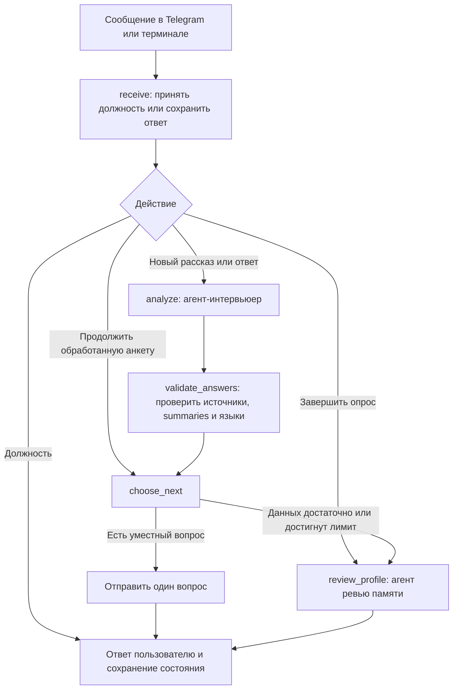
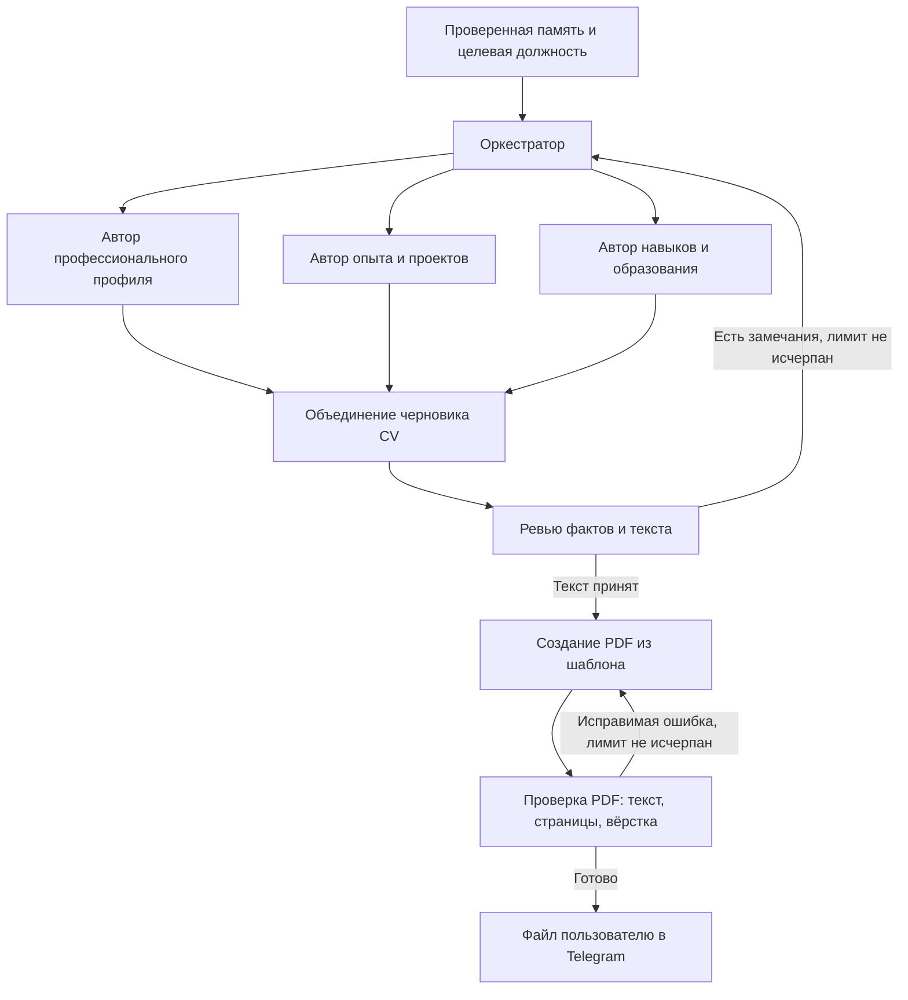

# CV Assistant

Мультиагентный помощник для подготовки резюме под выбранную должность. Пользователь
рассказывает о себе в Telegram, ассистент уточняет недостающие сведения, сохраняет
профиль и помогает представить опыт, навыки и образование в резюме.

Цель проекта — пройти весь путь от свободного рассказа до проверенного PDF,
который пользователь сможет использовать для откликов на LinkedIn, hh.ru и других
площадках. Резюме должно учитывать профессию, опираться на реальные сведения
и оставаться доступным для последующего редактирования.

**Текущий статус:** реализованы Telegram-интерфейс, интервью, постоянная память,
краткий профиль и агент ревью. Создание текста CV, экспорт PDF, фото и серверное
развёртывание находятся в планах. Прямых интеграций с площадками вакансий пока нет.

## Целевой сценарий

1. Пользователь указывает желаемую должность; в дальнейшем сможет добавить текст вакансии.
2. Рассказывает об опыте, навыках, образовании, проектах и языках в свободной форме.
3. Ассистент задаёт короткие вопросы с учётом профессии и уже полученных ответов.
   При неоднозначности уточняет смысл; пользователь может завершить интервью досрочно.
4. Агент ревью памяти выделяет подтверждённые сильные стороны, пробелы и противоречия.
5. Агенты подготовки CV составляют разделы, используя сохранённый профиль и требования вакансии.
6. Ревьюер проверяет факты, текст и полноту; замечания запускают ограниченный цикл исправлений.
7. Система создаёт PDF, проверяет его вёрстку и при необходимости исправляет документ.
   Фотография добавляется по желанию пользователя.
8. Пользователь получает файл в Telegram, проверяет его и может запросить изменения
   или подготовить другую версию под новую вакансию.

Первый законченный продукт должен выдавать файл для самостоятельного отклика.
Автоматическая отправка откликов и прямое управление профилями на площадках —
отдельное возможное направление после основного сценария.

## Что работает сейчас

| Компонент | Реализованное поведение |
| --- | --- |
| Telegram-интерфейс | Личные сообщения, меню, кнопки, краткие ответы и разбиение длинного текста |
| Управление анкетой | Начать, продолжить, завершить опрос, посмотреть профиль и рекомендации, очистить с подтверждением |
| Интервьюер | Groq `openai/gpt-oss-120b` анализирует историю, извлекает факты, пишет summaries и предлагает вопросы |
| Персонализация | Вопросы учитывают должность; программирование не предлагается повару, проекты обязательны не для каждой профессии |
| Уточнения | Приоритет у вопросов модели; для пропущенных тем предусмотрены резервные правила |
| Профиль | Имя, опыт, навыки, проекты, образование и отдельный список языков с уровнями |
| Редактура | Разделы профиля отображают сохранённые формулировки агента; исходные цитаты и история хранятся отдельно |
| Ревью памяти | Отдельный агент формулирует сильные стороны, вопросы для проверки и рекомендации |
| Постоянная память | SQLite сохраняет историю, факты, summaries, языки, ревью, этап интервью и режим меню |
| Восстановление | Ответ сохраняется при ошибке API; повтор продолжает незавершённый узел без дублирования ответа |
| Локальные режимы | Диалог в терминале и отдельный offline-режим без внешних API |

В меню и при просмотре профиля обычное сообщение не попадает в анкету: для ввода
ответа нужно нажать «Продолжить». Режим меню сохраняется после перезапуска.

Готовые формулировки неизменённых разделов сохраняются при продолжении интервью.
Для новых ответов запускается анализ; просмотр профиля и актуального сохранённого
ревью не требует обращения к модели. Старое ревью, состоящее из ссылок на исходные
факты, обновляется при первом открытии рекомендаций.

«Сильные стороны» — отдельные summaries агента с ссылками на подтверждающие факты.
Имя не используется как преимущество. «Рекомендации» показывают первые два пункта,
«Подробнее» — все, с теми же сохранёнными формулировками.

## Архитектура

Стек: **Python, aiogram, LangGraph, Pydantic, SQLite, Groq API**.

Сейчас используются два LLM-агента: **интервьюер** и **ревьюер профиля**.
Маршрутизацию выполняют переходы LangGraph и правила приложения.
Отдельный LLM-оркестратор, параллельные авторы CV и ревьюер готового документа
ещё не реализованы. Проверка цитат и выбор следующего шага выполняются Python-кодом.

### Текущий граф



Один вызов графа обрабатывает один ход. Между сообщениями состояние хранится
в SQLite; ожидание ответа не вызывает модель. После сбоя повтор возобновляет
незавершённый узел графа.

### Планируемое расширение

После интервью и ревью памяти оркестратор будет направлять подготовку CV:



Независимые разделы можно готовить параллельно после фиксации общей версии памяти.
Для обоих циклов исправлений нужны лимит попыток и явный результат при неудаче,
чтобы граф не зацикливался. Выбор способа маршрутизации оркестратора — правила,
LLM или их сочетание — предстоит определить при реализации.

## Память и достоверность

Данные разделены на исходные ответы, проверенные факты с цитатами, summaries
для отображения, языки и результаты ревью. Рекомендации агента не превращаются
в биографические факты.

- Цитата должна встречаться в ответе пользователя. Неподтверждённый факт отбрасывается.
- Отсутствие упоминания не означает отсутствие опыта или проектов.
- Неизвестные названия и сокращения нельзя раскрывать по догадке.
- Изучение технологии не должно превращаться в профессиональный опыт,
  попытка — в достижение, текущая учёба — в оконченный вуз.
- Уровень языка сохраняется как указанная самооценка. «Как носитель» не означает
  автоматически родной язык или подтверждённый C2. Неоднозначный общий уровень уточняется.
- Для summaries проверяются источники и некоторые изменения смысла, включая новые числа.
  Эти проверки не обеспечивают полной семантической достоверности текста.

`checkpoints` и `writes` хранят состояние выполнения LangGraph.
Таблица `profiles` содержит читаемую актуальную проекцию на пользователя:

| Поля | Содержимое |
| --- | --- |
| `user_id`, `stage`, `target_role`, `about` | Пользователь, этап, должность и первый рассказ |
| `turns_json` | История вопросов и ответов |
| `facts_json` | Проверенные факты с цитатами |
| `summaries_json` | Формулировки разделов от агента |
| `languages_json` | Языки и уровни |
| `review_json`, `updated_at` | Сохранённое ревью и время синхронизации |

Проекция обновляется после обработки сообщения, в том числе при сохранённом ответе
и ошибке модели. При запуске она синхронизируется из checkpoints без вызова LLM.
Подтверждённая очистка сбрасывает текущую анкету и состояние графа выбранного
пользователя. Политика полного удаления данных, включая резервные копии,
остаётся задачей перед публичным запуском.

## Ошибки, ограничения и задачи

### Исправленные ошибки

Следующие сценарии добавлены в регрессионные проверки; их нужно сохранять при
изменении промптов, схем данных и графа.

| Проблема | Текущее решение |
| --- | --- |
| «Имя: Меня зовут Артак», полный диалог в профиле | Нормализация имени; история открывается отдельно |
| Неизвестные разделы считались заполненными | Неупомянутые сведения не считаются фактами |
| Повару предлагались вопросы о программировании | Проверка уместности вопросов по профессии |
| Повторные вопросы после ответа или продолжения | Учёт темы, ключа детали и отдельных намерений по истории |
| Несколько языков попадали в одну строку, общий уровень терялся | Отдельные записи языков, обработка общего уровня и уточнений |
| Текст из меню записывался как ответ | Сохранённый режим меню, блокирующий ввод в анкету |
| После продолжения профиль возвращался к исходным репликам | Сохранение summaries неизменённых разделов и проверка их источников |
| Данные были в checkpoints, но не видны в `profiles` | Синхронизация читаемой таблицы с состоянием графа |
| В сильных сторонах показывались имя и исходные цитаты | Отдельные summaries ревьюера, единые для двух представлений |

### Открытые ограничения и риски

Это задачи по текущей реализации, а не утверждение, что каждый сценарий уже
воспроизведён как отдельный баг.

| Приоритет | Ограничение или риск | Что нужно сделать |
| --- | --- | --- |
| P0 | Ссылки на цитаты не гарантируют сохранение смысла summary | Добавить ревью противоречий, завышенных квалификаций и неподтверждённых выводов; показывать спорные сведения для подтверждения |
| P0 | Каждый новый ответ заново формирует весь набор фактов; неполный ответ модели может потерять прежние сведения | Ввести явное объединение, исправление и удаление фактов с версиями и проверками сохранности |
| P0 | Досрочное завершение после сбоя анализа позволяет перейти к ревью с ещё не разобранными ответами | Явно показывать необработанные сведения и определять, можно ли продолжать подготовку CV |
| P1 | Защита от повторов основана преимущественно на теме и ключе; она может пропустить смысловой дубль или заблокировать полезное уточнение | Различать уже заданный вопрос, ответ, отказ и действительно новую деталь |
| P1 | Языки и уровни частично разбираются правилами | Расширить набор проверок на опечатки, отрицания, смешанные уровни и поздние исправления |
| P1 | Если summary раздела не прошёл проверку, профиль может показать исходную формулировку | Добавить управляемый повтор редактуры и понятное состояние незавершённого раздела |
| P1 | Groq может вернуть лимит, таймаут или некорректный ответ | Сохранять восстановление; добавить наблюдаемость, контроль расхода и стратегию повторов без бесконечного ожидания |
| P1 | Должность хранится отдельно от содержимого вакансии; правки вносятся общей репликой | Добавить выбор поля для правки и отдельный контекст вакансии |
| P1 | Автотесты Telegram используют подмены и не подтверждают визуальное качество реального клиента | Регулярно проходить сценарии в Telegram Web и мобильном приложении с фиксацией результатов |
| P1 | Пока нет полного сценария «интервью → готовый файл» | Реализовать авторов CV, сборку, ревью, PDF и доставку |
| P2 | Локальный polling и SQLite ещё не подготовлены к публичной эксплуатации | Настроить окружение сервера, резервирование, миграции, мониторинг и нагрузочные проверки |

Сейчас одно сообщение ограничено 4000 символами, суммарные ответы — 12000.
Схема анализа допускает до 24 фактов и 12 пробелов; по умолчанию задаётся до пяти
уточнений за раунд. Эти ограничения нужно пересмотреть вместе со стратегией памяти.
Фото и голос пока не принимаются. Offline-режим сохраняет тематические ответы
дословно и не выполняет ИИ-анализ или генерацию сильных сторон.

## План развития

### 1. Стабилизировать интервью и память — ближайший этап

- [ ] Воспроизвести риски потери фактов, смысловых повторов и завершения после ошибки анализа.
- [ ] Определить правила добавления, исправления и удаления фактов с сохранением источников.
- [ ] Добавить проверку смысла summaries и сильных сторон; спорные утверждения уточнять у пользователя.
- [ ] Добавить редактирование отдельных разделов без сброса остальной анкеты.
- [ ] Пройти реальные сценарии для технической и нетехнической профессий, кандидата без опыта и многоязычного профиля.

**Критерий готовности:** новые ответы и исправления не теряют подтверждённые сведения,
повторный просмотр и перезапуск сохраняют профиль, ошибки API восстанавливаются
без дублирования, неразобранные ответы не маскируются под готовую анкету.

### 2. Создать текст CV

- [ ] Ввести отдельную структурированную модель CV, отличную от памяти интервью.
- [ ] Реализовать оркестрацию и авторов разделов; независимые задачи выполнять параллельно.
- [ ] Добавить сборку разделов, единый стиль, порядок и устранение повторов.
- [ ] Реализовать ревью фактов и текста с ограниченным числом исправлений.
- [ ] Показывать пользователю черновик для подтверждения и правок.

**Критерий готовности:** из сохранённого профиля получается связный черновик под
должность; биографические утверждения имеют источники, ошибки исправляются
в пределах лимита, пользователь может принять или изменить результат.

### 3. Выпустить PDF

- [ ] Создать шаблон с корректной кириллицей, переносами и извлекаемым текстом.
- [ ] Добавить фото по запросу и вариант без фотографии.
- [ ] Проверять текст PDF, переполнение, разрывы страниц и визуальную вёрстку.
- [ ] Отправлять файл в Telegram и поддержать повторную генерацию после правок.

**Критерий готовности:** пользователь получает читаемый PDF; длинные разделы и
несколько страниц не ломают вёрстку, содержание совпадает с принятым черновиком.

### 4. Подготовить публичный запуск

- [ ] Подготовить воспроизводимое серверное развёртывание и управление процессом бота.
- [ ] Настроить постоянное хранилище, миграции и проверяемое восстановление из резервных копий.
- [ ] Добавить мониторинг ошибок, времени обработки, расхода LLM и ограничения нагрузки.
- [ ] Определить правила хранения, экспорта и удаления персональных данных.
- [ ] Проверить изоляцию пользователей и полное прохождение сценария на сервере.

**Критерий готовности:** сервис восстанавливается после перезапуска, сохраняет
профили и файлы, позволяет диагностировать сбои и управлять пользовательскими данными.

### 5. Развить адаптацию под вакансии

- [ ] Принимать описание вакансии и отделять её требования от фактов о кандидате.
- [ ] Готовить несколько версий CV из одного профиля.
- [ ] Добавить выбор языка резюме и варианты оформления под способ подачи.
- [ ] Исследовать интеграции с LinkedIn, hh.ru и другими площадками после проверки
  доступных способов интеграции и требований каждой площадки.

## Установка и запуск

Из корня проекта:

```bash
python3 -m venv .venv
source .venv/bin/activate
python -m pip install -r requirements-dev.txt
```

Если `.env` отсутствует, создайте его на основе `.env.example`. Существующий файл
с настройками заменять не нужно.

```dotenv
TELEGRAM_BOT_TOKEN=
DATABASE_PATH=data/profiles.sqlite3
GROQ_API_KEY=
GROQ_MODEL=openai/gpt-oss-120b
MAX_FOLLOWUP_QUESTIONS=5
```

Telegram-токен создаётся через [@BotFather](https://t.me/BotFather), ключ модели —
в [Groq Console](https://console.groq.com/keys). `MAX_FOLLOWUP_QUESTIONS` принимает
значения от 1 до 10. Путь базы считается от корня проекта.

```bash
# Telegram: нужны TELEGRAM_BOT_TOKEN и GROQ_API_KEY
python main.py

# Терминал с моделью: нужен GROQ_API_KEY
python main.py --demo

# Терминал без внешних API и ключей
python main.py --demo --offline
```

`--demo` выбирает терминал, `--offline` отключает LLM. Локальная анкета имеет ID `-1`,
отдельный от Telegram-пользователей, но по умолчанию использует ту же базу.
Для изолированных проверок задайте другой `DATABASE_PATH`.

Бот отвечает, пока работает процесс Python. Закрытие Telegram его не останавливает.
Остановка — `Ctrl+C` или Stop в IDE; выход из диалога в терминале — `/exit`.
Для одного токена должен работать один polling-процесс. Временный запуск для
проверки следует завершать после её окончания.

`.env` и `data/` исключены из Git. В режиме Groq должность и ответы передаются
внешнему API для анализа. Постоянное размещение на сервере пока не настроено.

## Управление

Основные действия Telegram доступны кнопками:

| Кнопка | Действие |
| --- | --- |
| 🚀 Начать / 💬 Продолжить | Начать, дополнить анкету или повторить обработку после ошибки |
| 👤 Профиль | Посмотреть сохранённые сведения |
| 📝 Рекомендации | Открыть краткое ревью завершённой анкеты |
| 📖 Подробнее | Открыть полное ревью |
| ✅ Завершить опрос | Перейти к ревью с текущими данными |
| 🔄 Начать заново | Очистить текущую анкету после подтверждения |
| 📋 Меню | Перейти к выбору действий |

Команды доступны для терминала и совместимости:

| Команда | Назначение |
| --- | --- |
| `/start` | Показать текущий вопрос, сохранив анкету |
| `/menu`, `/help` | Меню и справка |
| `/go` | Автоматически выбрать продолжение или повтор |
| `/profile`, `/history` | Профиль и исходный диалог |
| `/review`, `/review_full` | Краткое и полное ревью |
| `/resume` | Продолжить анкету с сохранённой историей |
| `/continue` | Завершить интервью после указания должности |
| `/retry` | Повторить незавершённую обработку |
| `/restart` | Очистить анкету; в терминале выполняется сразу |

## Проверка качества

```bash
python -m pytest -q
```

Автотесты используют временные базы и подменённые вызовы Telegram/Groq без токенов
и доступа к сети. Они проверяют граф интервью, изоляцию пользователей, сохранение
и восстановление, меню, подтверждение очистки, вопросы по профессии, языки,
источники summaries, сохранение ревью и обновление старых форматов.

Проверки с настоящей моделью и визуальные проверки Telegram выполняются отдельно.
Прохождение автотестов не подтверждает качество каждого ответа LLM, отображение
на всех устройствах или готовность к публичному запуску. Для CV и PDF будут
добавлены проверки содержания, извлечения текста и визуального результата.

## Структура проекта

| Файл | Ответственность |
| --- | --- |
| `main.py` | Точка входа и выбор режима |
| `cv_assistant/config.py` | Настройки окружения |
| `cv_assistant/bot.py` | Telegram-обработчики и запуск polling |
| `cv_assistant/telegram_ui.py` | Кнопки, клавиатуры и разбиение сообщений |
| `cv_assistant/interview.py` | Команды, загрузка профиля и вызовы графа |
| `cv_assistant/graph.py` | Узлы и переходы интервью и ревью |
| `cv_assistant/models.py` | Схемы ответов модели и состояния |
| `cv_assistant/llm.py` | Агент-интервьюер и клиент Groq |
| `cv_assistant/reviewer.py` | Агент ревью и представление рекомендаций |
| `cv_assistant/memory.py` | Проверка источников, summaries и пробелов |
| `cv_assistant/languages.py` | Разбор языков, уровней и уточнений |
| `cv_assistant/storage.py` | SQLite, проекция профилей и режим интерфейса |
| `tests/` | Автоматические и регрессионные проверки |
